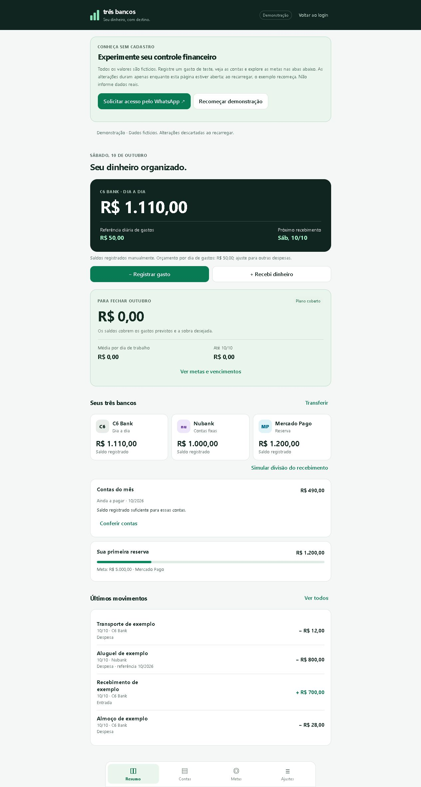

# Facilitador de Vida

**Uma visão do dinheiro do dia a dia, das contas fixas e da reserva.**

Aplicação web de controle financeiro pessoal com receitas, despesas, transferências e planejamento mensal. A proposta organiza três contas em funções distintas e ajuda a visualizar quanto ainda falta para fechar o mês.

[**Experimentar demonstração**](https://facilitador-financeiro-nsex.onrender.com/demo/) · [Acesso privado](https://facilitador-financeiro-nsex.onrender.com/) · [Guia de uso](docs/OPERACAO.md)

> A demonstração é pública, dispensa cadastro e usa somente valores fictícios. As alterações são descartadas ao recarregar.



## O problema

Somar saldos não mostra, por si só, o dinheiro disponível: parte pode estar reservada para contas e objetivos. O sistema separa essas finalidades e calcula metas considerando vencimentos, orçamento e recebimentos previstos pelo usuário.

## Funcionalidades

- Registro de entradas, despesas e transferências entre contas.
- Contas fixas por mês, vencimentos e acompanhamento de pagamentos.
- Metas para fechar o mês e acompanhamento da reserva.
- Exportação e restauração de cópias com validação antes de substituir dados.
- Login privado, sessão no servidor e proteção de operações por CSRF.
- Sincronização opcional com PostgreSQL e tratamento de alterações concorrentes.
- Integração opcional para consulta e conferência de saldos bancários.

## Tecnologias e arquitetura

| Camada | Implementação |
| --- | --- |
| Interface | HTML, CSS e JavaScript |
| Servidor | Node.js, módulo HTTP nativo |
| Persistência | Armazenamento no navegador e PostgreSQL opcional |
| Autenticação | Senha derivada com scrypt e sessão HttpOnly |
| Testes | Node Test Runner e PostgreSQL em WASM com PGlite |
| Hospedagem | Render |

Os cálculos monetários usam centavos. Transferências não entram novamente como receita ou despesa, e a reserva fica fora do saldo disponível por padrão.

As APIs privadas exigem sessão no servidor. Na sincronização, o controle de versão detecta conflitos; o usuário escolhe como resolvê-los. A demonstração usa armazenamento em memória e arquivos explicitamente permitidos, sem acessar dados reais ou APIs bancárias.

## Executar e testar

Requisito: **Node.js 22 ou superior**.

```sh
git clone https://github.com/luannascimentopsp-droid/tres-bancos.git
cd tres-bancos
npm ci --include=dev --ignore-scripts
npm test
```

Para iniciar o servidor, configure o login e a origem conforme [INTEGRACAO-BANCARIA.md](INTEGRACAO-BANCARIA.md) e execute `npm start`. A consulta bancária é opcional; não é necessária para testar os cálculos. Para sincronização, consulte [SINCRONIZACAO.md](SINCRONIZACAO.md).

Não existe senha padrão. Credenciais e conexão do banco são configuradas no servidor.

## O que os testes verificam

- Cálculos financeiros, orçamento e planejamento mensal.
- Restauração de cópias e rejeição de dados inválidos.
- Autenticação, sessão e proteção das APIs.
- Persistência, sincronização e controle de versão.
- Isolamento da demonstração e integração bancária com cenários de teste.

## Estrutura

```text
core.js, planner.js   Cálculos e regras do planejamento
app.js, *-ui.js       Telas e interação
web-store.js         Persistência no navegador
cloud-store.js       Sincronização
server/              HTTP, autenticação, banco e integração
tests/               Testes automatizados
```

## Limites atuais

O serviço privado usa um único usuário autorizado, sem cadastro público. A sincronização depende da configuração de PostgreSQL. A integração bancária consulta saldos; não importa extratos automaticamente e não realiza pagamentos ou transferências. Seu uso real depende de credenciais e autorização do provedor.

O [guia de uso e operação](docs/OPERACAO.md) detalha regras de cálculo, cópias de segurança e limitações. Os valores de exemplo da demonstração não representam dados pessoais.

---

Projeto do portfólio de [Luan Nascimento](https://github.com/luannascimentopsp-droid).


## Agenda e lembretes

A aba Agenda guarda compromissos com anotação, data, horário, antecedência de aviso e repetição anual opcional. Os itens fazem parte do estado da conta, das cópias e da sincronização online. O aviso interno aparece quando o Facilitador está aberto. Cada navegador pode ativar notificações por meio do botão explícito na agenda; notificações fora da página e funcionamento com o app fechado não fazem parte desta versão.
